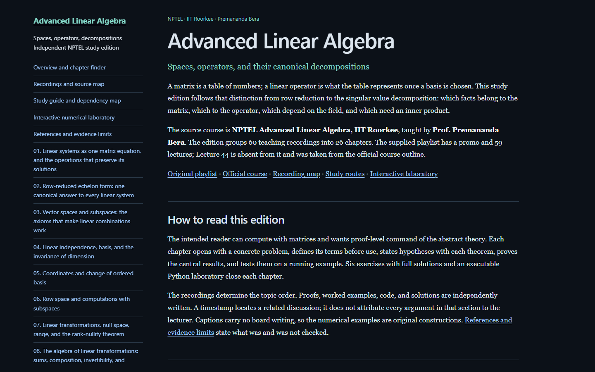

# Advanced Linear Algebra

**[Read the textbook](https://az9713.github.io/nptel-advanced-linear-algebra-notes/)** · **[Recording map](https://az9713.github.io/nptel-advanced-linear-algebra-notes/source-map.html)** · **[Study guide](https://az9713.github.io/nptel-advanced-linear-algebra-notes/study-guide.html)** · **[Interactive laboratory](https://az9713.github.io/nptel-advanced-linear-algebra-notes/numerical-lab.html)**

An independent, transcript-grounded study edition of **NPTEL Advanced Linear Algebra**, taught by **Prof. Premananda Bera, IIT Roorkee**. The recordings supply the topic order. Proofs, worked examples, Python laboratories and exercise solutions are independently written.

[Official course](https://nptel.ac.in/courses/111107164) · [Supplied playlist](https://www.youtube.com/playlist?list=PLLy_2iUCG87ChONRU6EeO6A2rIzM3HUvG)

[](https://az9713.github.io/nptel-advanced-linear-algebra-notes/)

## Scope

**26 chapters cover 60 teaching recordings**; the introductory promo is kept in the source inventory. Each chapter has six exercises with solutions and one executable laboratory. Chapter lengths range from 1,712 to 8,061 words of manuscript source. The topics run from linear systems and vector spaces through duality, canonical forms and inner-product spaces to the singular value decomposition.

The playlist does not contain Lecture 44. The official NPTEL outline supplied it (position 61).

## Chapter directory

| Chapter | Topic | Recording positions |
|---|---|---|
| [01](https://az9713.github.io/nptel-advanced-linear-algebra-notes/ch01.html) | Linear systems as one matrix equation, and the operations that preserve its solutions | 2, 3 |
| [02](https://az9713.github.io/nptel-advanced-linear-algebra-notes/ch02.html) | Row-reduced echelon form: one canonical answer to every linear system | 4 |
| [03](https://az9713.github.io/nptel-advanced-linear-algebra-notes/ch03.html) | Vector spaces and subspaces: the axioms that make linear combinations work | 5, 6 |
| [04](https://az9713.github.io/nptel-advanced-linear-algebra-notes/ch04.html) | Linear independence, basis, and the invariance of dimension | 7, 8 |
| [05](https://az9713.github.io/nptel-advanced-linear-algebra-notes/ch05.html) | Coordinates and change of ordered basis | 9 |
| [06](https://az9713.github.io/nptel-advanced-linear-algebra-notes/ch06.html) | Row space and computations with subspaces | 10, 11 |
| [07](https://az9713.github.io/nptel-advanced-linear-algebra-notes/ch07.html) | Linear transformations, null space, range, and the rank-nullity theorem | 12, 13 |
| [08](https://az9713.github.io/nptel-advanced-linear-algebra-notes/ch08.html) | The algebra of linear transformations: sums, composition, invertibility, and isomorphism | 14, 15, 16 |
| [09](https://az9713.github.io/nptel-advanced-linear-algebra-notes/ch09.html) | Matrix representation of linear transformations and similarity | 17, 18 |
| [10](https://az9713.github.io/nptel-advanced-linear-algebra-notes/ch10.html) | Linear functionals, dual spaces, and dual bases | 19, 20, 21 |
| [11](https://az9713.github.io/nptel-advanced-linear-algebra-notes/ch11.html) | Annihilators, the double dual, and the transpose of a linear map | 22, 23 |
| [12](https://az9713.github.io/nptel-advanced-linear-algebra-notes/ch12.html) | Eigenvalues, eigenvectors, and the characteristic polynomial | 24, 25 |
| [13](https://az9713.github.io/nptel-advanced-linear-algebra-notes/ch13.html) | Diagonalizable operators and annihilating polynomials | 26, 27 |
| [14](https://az9713.github.io/nptel-advanced-linear-algebra-notes/ch14.html) | The Cayley-Hamilton theorem and the minimal polynomial in computation | 28, 29 |
| [15](https://az9713.github.io/nptel-advanced-linear-algebra-notes/ch15.html) | Invariant subspaces, conductors, and triangulability | 30, 31 |
| [16](https://az9713.github.io/nptel-advanced-linear-algebra-notes/ch16.html) | Applications of invariant subspaces: diagonalizability criteria and simultaneous triangulation | 32, 33 |
| [17](https://az9713.github.io/nptel-advanced-linear-algebra-notes/ch17.html) | Direct-sum decompositions and projections | 34, 35 |
| [18](https://az9713.github.io/nptel-advanced-linear-algebra-notes/ch18.html) | Invariant direct sums and block-diagonal operators | 36, 37 |
| [19](https://az9713.github.io/nptel-advanced-linear-algebra-notes/ch19.html) | The primary decomposition theorem | 38, 39 |
| [20](https://az9713.github.io/nptel-advanced-linear-algebra-notes/ch20.html) | Applications of primary decomposition: diagonalizable plus nilpotent parts | 40, 41, 42 |
| [21](https://az9713.github.io/nptel-advanced-linear-algebra-notes/ch21.html) | Inner products, norms, and the Cauchy-Schwarz inequality | 43, 44, 61, 45 |
| [22](https://az9713.github.io/nptel-advanced-linear-algebra-notes/ch22.html) | Orthogonal projection, Gram-Schmidt, and best approximation | 47, 46 |
| [23](https://az9713.github.io/nptel-advanced-linear-algebra-notes/ch23.html) | Linear functionals and adjoint operators on inner product spaces | 48, 49, 50, 51 |
| [24](https://az9713.github.io/nptel-advanced-linear-algebra-notes/ch24.html) | Inner-product-space isomorphisms and unitary operators | 52, 53, 55, 54 |
| [25](https://az9713.github.io/nptel-advanced-linear-algebra-notes/ch25.html) | Normal operators and spectral resolution | 56, 57, 58 |
| [26](https://az9713.github.io/nptel-advanced-linear-algebra-notes/ch26.html) | Singular value decomposition and forms on inner product spaces | 59, 60 |

## Source boundary and limits

This is **not endorsed by, affiliated with, or an official publication of NPTEL, IIT Roorkee, or the instructor**. Recordings, captions and cited books belong to their rights holders and are not redistributed. [Attribution and rights](RIGHTS.md).

- Caption evidence is the NPTEL-verified English track, except for the promo and Lecture 29. The verified track of Lecture 29 carries the Lecture 22 text, so YouTube automatic captions were used.
- Captions carry no board writing. The numerical examples are original constructions. No complete audit of video, boards or audio was made.
- The cited books were not retrieved, so citations name a book or chapter only.
- Each chapter has one AI cross-review by an agent that did not write it. This is not human expert certification or formal proof verification.

[Source manifest](source-manifest.json) · [References and limits](https://az9713.github.io/nptel-advanced-linear-algebra-notes/references.html) · reviews and reading ledgers in `validation/`.

## Read offline

Download the repository ZIP, extract it and open `index.html`. Recordings and external references need a network connection.

## Build and verify

Use Python 3.13 in a virtual environment.

```text
python -m pip install -r requirements.txt
python figures/make_figures.py
python tools/build.py
python tools/check.py
python tools/audit_book.py
python tools/release_check.py
python tools/package_metadata.py
python -m playwright install chromium
python tools/browser_check.py
```

[Production workflow](WORKFLOW.md) · [Book specification](plan/book-spec.json). MathJax is bundled under the [Apache 2.0 license](assets/mathjax-LICENSE).
