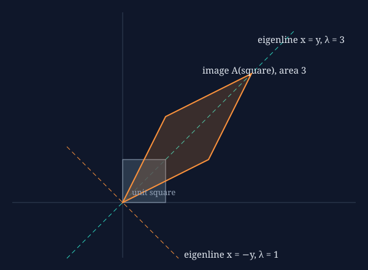
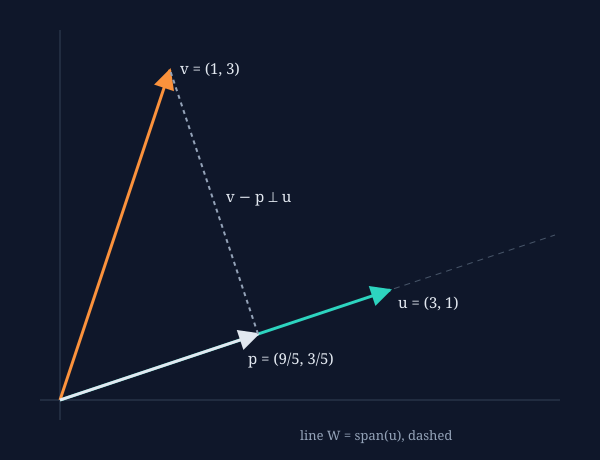

# Interactive numerical laboratory

These experiments run locally in the browser on small inputs. They illustrate results proved in the chapters; they do not replace the proofs. Each chapter also has a downloadable Python laboratory that checks its examples in exact rational arithmetic where possible. The browser computations below use floating-point numbers with a tolerance of $10^{-10}$ to $10^{-12}$, so an input that is singular only after rounding can be misclassified.

## Row reduction, rank, and nullity

Let $A$ be a $3\times 4$ real matrix. Gauss–Jordan elimination with row swaps, row scaling, and row replacement produces its row-reduced echelon form $R$ ([Chapter 2](ch02.md)). Row operations do not change the solution set of $Ax=0$ ([Chapter 1](ch01.md)), so the number of pivot columns of $R$ is the rank of $A$ and the number of free columns is $\dim\ker A$. The rank-nullity theorem of [Chapter 7](ch07.md) then reads $\operatorname{rank}A+\operatorname{nullity}A=4$, and the output below shows both numbers.

<label>a₁₁<input id="rr-00" type="number" value="1"></label><label>a₁₂<input id="rr-01" type="number" value="2"></label><label>a₁₃<input id="rr-02" type="number" value="1"></label><label>a₁₄<input id="rr-03" type="number" value="0"></label>
<label>a₂₁<input id="rr-10" type="number" value="2"></label><label>a₂₂<input id="rr-11" type="number" value="4"></label><label>a₂₃<input id="rr-12" type="number" value="0"></label><label>a₂₄<input id="rr-13" type="number" value="2"></label>
<label>a₃₁<input id="rr-20" type="number" value="3"></label><label>a₃₂<input id="rr-21" type="number" value="6"></label><label>a₃₃<input id="rr-22" type="number" value="1"></label><label>a₃₄<input id="rr-23" type="number" value="2"></label>

Rank: <output id="rr-rank"></output>; pivot columns: <output id="rr-pivots"></output>; nullity: <output id="rr-null"></output>

<pre class="lab-output" id="rr-rref" aria-live="polite"></pre>

For the default matrix the third row is the sum of the first two, and the second column is twice the first. The rank is therefore 2, the pivots are columns 1 and 3, and the null space has dimension 2. Change $a_{34}$ from 2 to 3: the third row is no longer a combination of the first two, the rank becomes 3, and the nullity falls to 1.

## A 2×2 operator: eigenvalues, diagonalizability, Cayley–Hamilton

Let $A=\begin{pmatrix}a&b\\c&d\end{pmatrix}$ act on $\mathbb{R}^2$. Its characteristic polynomial is $c_A(x)=x^2-(\operatorname{tr}A)x+\det A$, with discriminant $(\operatorname{tr}A)^2-4\det A$ ([Chapter 12](ch12.md)). Three cases exist. A positive discriminant gives two distinct real eigenvalues, hence a basis of eigenvectors. A negative discriminant gives no real eigenvalue, so $A$ has no eigenvector in $\mathbb{R}^2$, although it is diagonalizable over $\mathbb{C}$. A zero discriminant gives a repeated eigenvalue $\lambda$; then $A$ is diagonalizable exactly when $A=\lambda I$, because otherwise its minimal polynomial is $(x-\lambda)^2$ ([Chapter 13](ch13.md)). The Cayley–Hamilton theorem ([Chapter 14](ch14.md)) states $A^2-(\operatorname{tr}A)A+(\det A)I=0$; the residual printed below measures that matrix in floating point.

<label>a<input id="op-a" type="number" value="2" step="0.5"></label><label>b<input id="op-b" type="number" value="1" step="0.5"></label><label>c<input id="op-c" type="number" value="1" step="0.5"></label><label>d<input id="op-d" type="number" value="2" step="0.5"></label>

Trace: <output id="op-trace"></output>; determinant: <output id="op-det"></output>; eigenvalues: <output id="op-eig"></output>

The default $A=\begin{pmatrix}2&1\\1&2\end{pmatrix}$ has trace 4, determinant 3, and eigenvalues 3 and 1, with eigenvectors $(1,1)$ and $(1,-1)$. Fig. 1 shows that $A$ stretches the line $x=y$ by 3 and fixes the line $x=-y$ pointwise. The unit square maps to a parallelogram of area $|\det A|=3$. Now set $b=1$, $c=0$, $a=d=2$: the eigenvalue 2 repeats, but $A\neq 2I$, so no eigenvector basis exists. Set $b=-1$, $c=1$, $a=d=0$: the rotation by a quarter turn has no real eigenvalue.

On narrow screens, pan the figures sideways to keep their labels readable.

<figure>

<figcaption>Fig. 1. The image of the unit square under $A=\begin{pmatrix}2&1\\1&2\end{pmatrix}$. The dashed eigenlines are invariant subspaces (<a href="ch15.html">Chapter 15</a>). Generated by figures/make_figures.py.</figcaption></figure>

## Orthogonal projection onto a line

In $\mathbb{R}^2$ with the dot product, the orthogonal projection of $v$ onto $W=\operatorname{span}(u)$, $u\neq0$, is $p=\frac{\langle v,u\rangle}{\langle u,u\rangle}u$. It is the unique vector of $W$ with $v-p\perp u$, and it is the best approximation to $v$ from $W$ ([Chapter 22](ch22.md)). For $u=(3,1)$ and $v=(1,3)$, $\langle v,u\rangle=6$ and $\langle u,u\rangle=10$, so $p=\tfrac35(3,1)=(9/5,3/5)$ and $v-p=(-4/5,12/5)$, whose dot product with $u$ is $-12/5+12/5=0$. Fig. 2 draws the construction; the figure generator asserts both equalities in exact arithmetic.

<figure>

<figcaption>Fig. 2. The error $v-p$ is orthogonal to $W$, which is the characterization of the best approximation in an inner-product space (<a href="ch22.html">Chapter 22</a>).</figcaption></figure>
